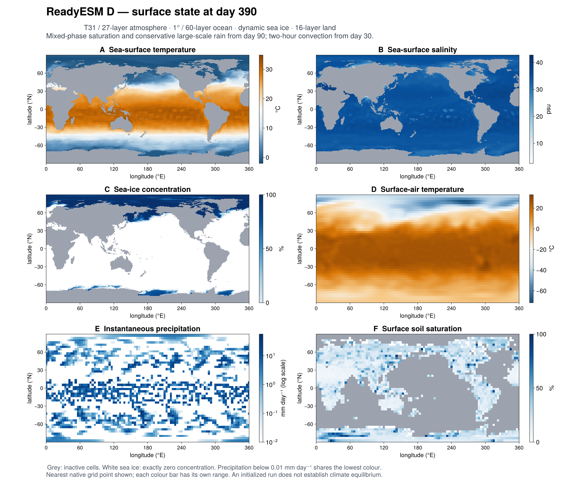

# ReadyESM

ReadyESM couples SpeedyWeather, RRTMGP, Oceananigans, ClimaSeaIce and Terrarium.
The current model is a T31/L27 atmosphere over a 1° tripolar, 60-level ocean,
with dynamic sea ice and 16-layer land. ERA5 and ECCO provide the initial state.

This is a research model under development, not a calibrated projection model.
The production configuration is [`config/production.yml`](config/production.yml).

The `v0.1.8` candidate adds mixed liquid/ice saturation and net-column
large-scale rain diagnosis: surface rain matches that scheme's column water
removal, but total atmospheric water is not conserved. Two-hour convection,
double-precision land and cloud paths of 75/25 g/m² are retained.
See the [release history](HISTORY.md) and
[validation record](docs/validation-v0.1.8.md).

The D experiment reaches day 390. Over matched days 360–384, net
top-of-atmosphere energy uptake falls from 8.75 to 3.49 W/m². The atmosphere
is 1.36 K cooler and 4.07 kg/m² drier than the control; its unclosed water
budget grows by 5.43 kg/m² over days 90–384, versus 2.17 in the control.
Ocean hot cells, coastal ice pile-up and whole-system energy closure remain
unresolved. Release-package qualification is in progress.



*A 390-day initialised run; v0.1.8 candidate physics from day 90.*
[Timelines](docs/readiesm-v0.1.8-timelines.png) ·
[Figure provenance](docs/readiesm-v0.1.8-snapshot.json)

## Run

The production configuration requires Julia 1.12 and an NVIDIA GPU with
working CUDA drivers.

```bash
julia --project=. -e 'using Pkg; Pkg.instantiate()'
python -m pip install -r scripts/requirements.txt
python scripts/download_era5_initial_state.py --include-stratosphere
julia --project=. scripts/run_dynamic_esm.jl config/production.yml
```

The ERA5 download requires CDS credentials. The January 1993 ECCO V4r4 files
download through ClimaOcean/NumericalEarth, with a public
[NumericalEarthArtifacts mirror](https://github.com/NumericalEarth/NumericalEarthArtifacts/releases/tag/data-v1)
when the primary ECCO download fails. Initial downloads require network access;
later runs reuse the cached inputs. `scripts/prepare_ecco_monthly_bundle.jl`
can verify and arrange a local monthly bundle for an explicit
`ecco_initial_conditions_directory`.

The runner validates its diagnostics and writes results under
`artifacts/production`. To make a final-day atlas:

```bash
julia --project=. scripts/plot_final_day_summary.jl \
    artifacts/production/diagnostics.nc artifacts/production/final_day.png
```

CO2 is an active prescribed concentration in RRTMGP. Sulfate aerosol can be
applied as prescribed optical depth. There is no interactive carbon cycle,
emissions-driven CO2 or aerosol chemistry yet.

See [`NOTES.md`](NOTES.md) for the present scientific limitations and
[`HISTORY.md`](HISTORY.md) for the short model history.

## Test

The CPU regression suite uses synthetic initial conditions and requires no
ERA5 credentials or GPU. After instantiating the pinned environment, run:

```bash
julia --project=. --startup-file=no test/runtests.jl
```

The Fourier graph cache and conservative regridding regressions need a CUDA
GPU but no input downloads:

```bash
julia --project=. --startup-file=no test/cuda_graph_cache.jl
julia --project=. --startup-file=no test/csr_regridding_gpu.jl
```

On a CUDA machine with the production inputs, the short coupled and restart
checks run in separate Julia processes:

```bash
julia --project=. scripts/validate_coupled_smoke.jl artifacts/release-smoke
julia --project=. scripts/validate_coupled_restart.jl \
    artifacts/release-smoke/hour1_restart.jld2 artifacts/release-restart
julia --project=. scripts/compare_dynamic_restart_boundaries.jl \
    artifacts/release-restart artifacts/release-smoke/hour1_restart.jld2 \
    artifacts/release-restart/restored_boundary.jld2
```

These checks exercise one simulated hour followed by an independently restored
hour at production resolution. They verify exact restoration of checkpointed
model state and finite continuation. They do not establish a stationary climate
or exact equality between continuous and restarted trajectories. Model
construction and the first GPU step can take hours despite the short simulated
duration.

Checkpoints made before v0.1.4's native-runoff repair lack pending exchange
water and are rejected explicitly.
The v0.1.6 production configuration uses `terrarium_precision: float64`;
old Float32 land checkpoints cannot be converted implicitly. Start fresh or
use a native Float64 checkpoint. To continue a compatible Float32 checkpoint,
retain `terrarium_precision: float32` and its original forcing settings.
