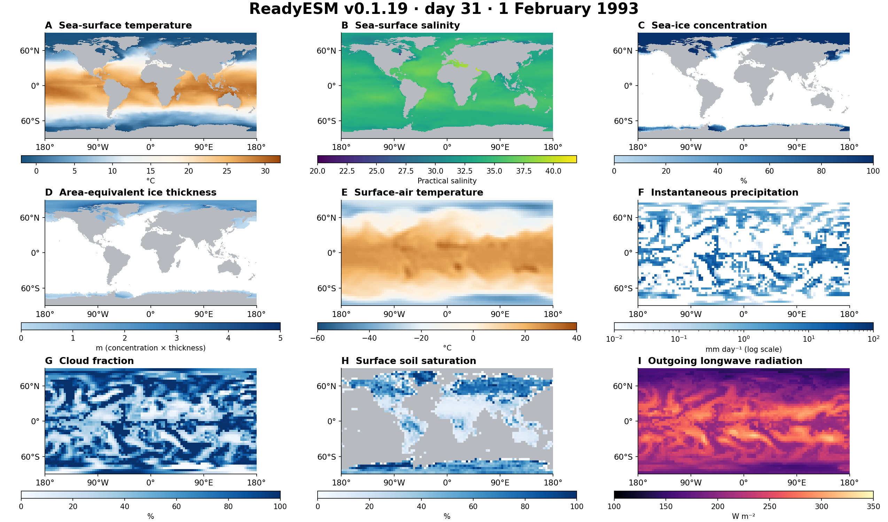
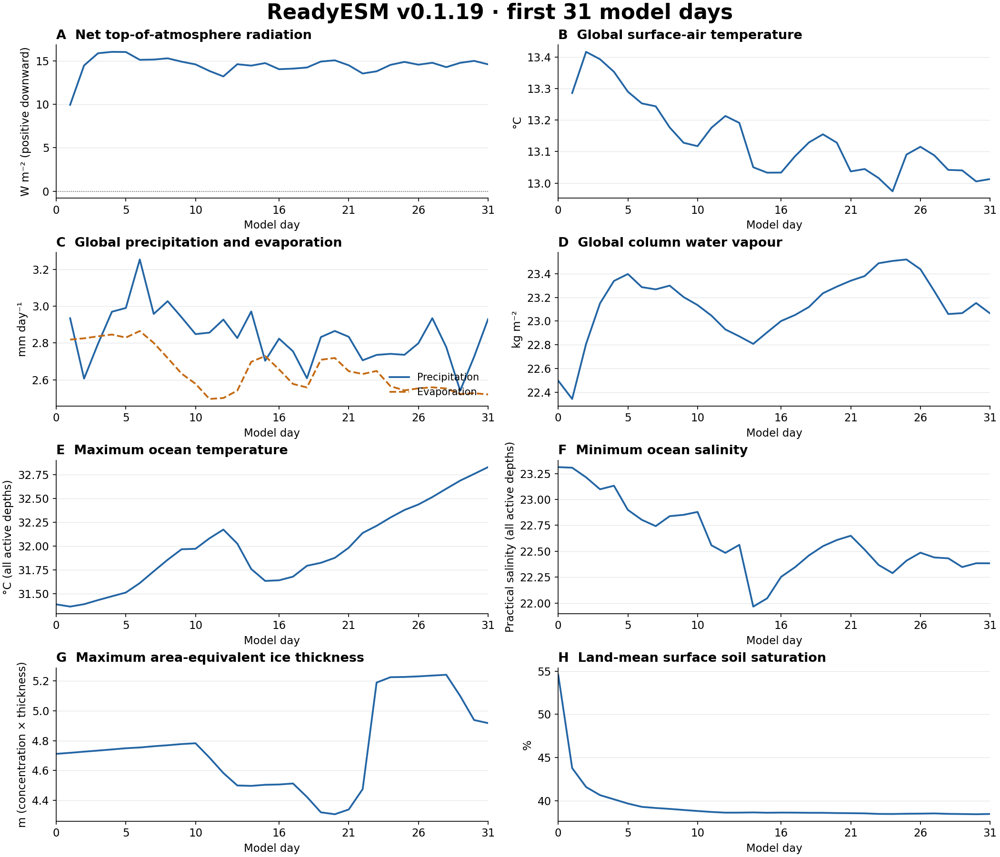
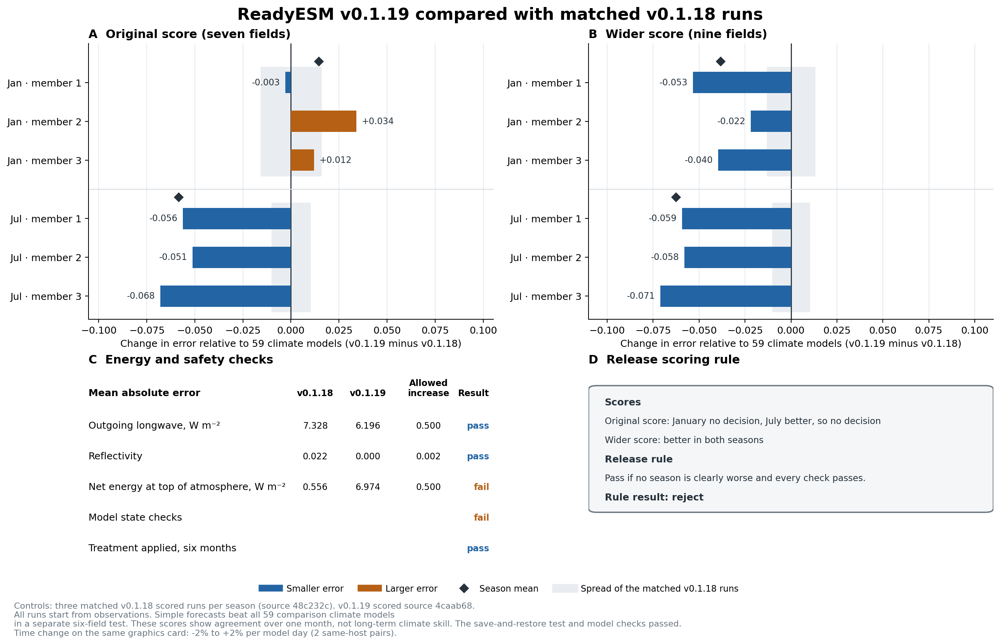

# ReadyESM

ReadyESM is a global climate model written in Julia. It couples SpeedyWeather
for the atmosphere, RRTMGP for radiation, Oceananigans for the ocean,
ClimaSeaIce for sea ice and Terrarium for land.

In the standard setup, the atmosphere has a grid spacing of about 400 km
(spectral resolution T31) and 27 levels. The ocean has a grid spacing of
about 1 degree and 60 levels. The land has 16 soil layers. ERA5 supplies the
initial atmosphere and land state. ECCO supplies the ocean and sea ice.



January 1993, first of three runs, after 31 days with v0.1.19 source
`4caab689`.
This run starts from observations. It is one run, not a long-term climate
mean. Grey marks inactive cells. Ice-free ocean is white.



The same run from day 0 to day 31. Radiation shows daily means. Other panels
show daily samples. Ocean extrema cover all active depths and can move between
cells.
[Figure data, source hashes and methods](docs/readiesm-v0.1.19-figures.json).

## v0.1.19 paired comparison



Three 31-day runs in each season compare v0.1.19 with v0.1.18 from the same
observed starts. Error across nine weather fields fell in both seasons.
The frozen release score nevertheless **rejected** v0.1.19. The two-season
absolute imbalance in energy at the top of the atmosphere grew from 0.56 to
6.97 W m⁻², against an allowance of 0.5 W m⁻² for the change. At the end of
January, Antarctic sea-ice extent was 4.17–4.30 million km² in v0.1.19,
against 3.00–3.03 million km² in the controls and 2.96 million km² in daily
observations. This is a **qualified release with known failures**. The score
and failed checks are unchanged. See the
[validation record](docs/validation-v0.1.19.md) and
[figure values and source hashes](docs/readiesm-v0.1.19-comparison.json).
The [plot recipe](docs/plot-v0.1.19-comparison.py) renders the comparison
from that figure record.

In a separate six-month run from a January 1993 start, the June air
temperature about 5.5 km above sea level between 30 and 60°N was 0.83°C
too cold, compared with 5.32°C too cold using the matched v0.1.18 settings.
That is one pair of runs. It does not show how a stable climate would behave.
The model uses 1365 W m⁻² for the Sun's energy output. The same value was
used in earlier versions. In this six-month run, incoming sunlight averaged
0.89 W m⁻² above the ERA5 reference. This explains only part of the energy
imbalance. The remaining causes are under investigation.

These runs start from observations. In a separate six-field test, two simple
guesses (the long-term average, and the starting difference from that average
held fixed) scored better than all 59 CMIP6 models. The ranks here show
agreement with the observed month, not the skill of the model's own long-term
climate. The [paired scorecard](scorecard.png),
[development scorecard](development_scorecard.png) and
[version history](readyesm_scorecard_versions.png) show the v0.1.19 evidence
and its failed checks.
The version history uses one start per season. The paired comparison estimates
the change in that release. The
[version-history figure record](docs/readyesm_scorecard_versions_v019.json)
gives its source hashes. The [paired score values](scorecard_v4_data.json) and
[development figure provenance](docs/development_scorecard_v019_provenance.json)
record the frozen outcomes and GPU gate receipts behind the other two
scorecards.

## Speed

Measured on 20 October 2026, before v0.1.14, on JASMIN with one NVIDIA
A100 40 GB and four CPU threads.
Two fresh processes each timed three model days after warm-up.

| Atmosphere | Ocean cells | Simulated years per day | Start-up |
| --- | --- | ---: | ---: |
| T15, 27 levels | 180×90×60 | 15.1 | 45–52 min |
| T15, 27 levels | 360×180×60 | 11.1 | 45–51 min |
| T15, 27 levels | 720×360×60 | 4.5 | 47–53 min |
| T31, 27 levels | 180×90×60 | 8.2 | 45–52 min |
| T31, 27 levels | 360×180×60 | 5.7 | 46–53 min |
| T31, 27 levels | 720×360×60 | 2.4 | 48–54 min |
| T63, 27 levels | 360×180×60 | 3.0 | 48–54 min |
| T127, 27 levels | 360×180×60 | 1.1 | 55–61 min |

The rate covers integration with daily budget diagnostics. Start-up includes
loading, model construction, initialization and warm-up.
T63 and T127 used a wider land-data search for a few island cells during
initialization, for timing only.
[Timing details](docs/performance.md).

## Run

Use Julia 1.12 and Python 3.11 or newer. The standard configuration uses an NVIDIA GPU
with CUDA. The project asks for CUDA runtime 13.2. Check that your NVIDIA
driver supports it. CPU runs are also supported.

```bash
git clone https://github.com/kieranmrhunt/ReadyESM.git
cd ReadyESM
julia --project=. -e 'using Pkg' -e 'Pkg.instantiate()'
python -m pip install -r scripts/requirements.txt
```

Follow the [input-data setup](docs/running.md#input-data) to prepare ERA5 and
ECCO for 1 January 1993. Then copy the standard configuration:

```bash
cp config/production.yml config/my_run.yml
```

For a 31-day run, change these entries in the copied file:

```yaml
name: my_run
duration_days: 31
analysis_start_day: 0
output_dir: artifacts/my_run
```

Start the model from the repository directory:

```bash
julia --project=. scripts/run_dynamic_esm.jl config/my_run.yml
```

The first model build and GPU compilation can take hours. Results are written
to the configured output directory. To plot the final day and timelines:

```bash
python scripts/plot_readme.py artifacts/my_run/diagnostics.nc \
    artifacts/my_run/summary --version v0.1.19 --expected-days 31
```

For files of monthly and yearly climate fields, see the
[climate output guide](docs/climate-output.md). For the week-by-week
temperature comparison with ERA5, see the
[drift-screen guide](docs/drift-screen.md).
The standard settings return energy lost from the wind to the air as heat.
They also use monthly ERA5 land brightness, plant cover and leaf area. Their
input files and recorded hashes are in
`data/era5_seasonal_land_cycle_1993/` and
`data/era5_realistic_albedo_1993/`. The three changes were tested together
in paired months and a six-month continuous run. See the
[validation record](docs/validation-v0.1.19.md)
and [known limitations](NOTES.md).

## Configuration

Edit the existing entries in the YAML file. Forcing options sit under
`forcing:`.

| Option | Standard value | Meaning |
| --- | --- | --- |
| `device` | `gpu` | Use `gpu` or `cpu`. |
| `truncation`, `nlayers` | `31`, `27` | Atmospheric horizontal truncation and vertical levels. |
| `duration_days`, `analysis_start_day` | `730`, `365` | Run length and a recorded analysis-start day. The current runner saves `analysis_start_day` in the metadata. It does not use it to choose which days to average. It must be less than `duration_days`. |
| `atmosphere_hyperdiffusion_hours` | `4` | Time over which the model smooths small-scale noise in wind, temperature and humidity. A longer time gives weaker smoothing. |
| `atmosphere_divergence_hyperdiffusion_hours` | `4` | Time over which the model smooths the divergent part of the wind. v0.1.16 used 1 hour. A restart from a saved state with a different value stops with an error. |
| `atmosphere_vertical_advection` | `centered_full_temperature` | Transport full temperature vertically. Select `speedyweather_0_21_1_centered` for the older advection behaviour in a new run. Checkpoints from earlier releases cannot be restarted directly in v0.1.17. |
| `atmosphere_vertical_diffusion` | `holtslag_boville_k_profile_v1` | Mix momentum vertically in the atmospheric boundary layer. Requires Oceananigans and Terrarium. |
| `atmosphere_pbl_diffusivity_scale` | `1.0` | Multiply the boundary-layer mixing coefficient by a value greater than 0 and at most 1. |
| `atmosphere_pbl_mix_heat`, `atmosphere_pbl_mix_humidity`, `atmosphere_pbl_mix_momentum` | `false`, `false`, `true` | Select the fields mixed by the boundary-layer scheme. |
| `atmosphere_dissipative_heating` | `kinetic_energy_v1` | Return diagnosed wind-energy losses from drag, mixing and numerical smoothing as heat. The generic experiment default is `off`. |
| `atmosphere_convection` | `betts_miller_sigma_rh_v1` | Betts–Miller with a vertical humidity profile. Use `betts_miller_constant_rh` for the previous scheme. |
| `atmosphere_convection_upper_relative_humidity`, `atmosphere_convection_lower_relative_humidity` | `0.5`, `0.7` | Reference relative humidity above and below the transition. |
| `atmosphere_convection_transition_top_sigma`, `atmosphere_convection_transition_bottom_sigma` | `0.3`, `0.7` | Bounds of the linear transition in pressure fraction. |
| `atmosphere_convection_timescale_seconds` | `7200` | Betts–Miller adjustment time. |
| `sea_ice_dynamics` | `true` | Set to `false` to disable ice motion. |
| `atmosphere_moist_mass_coupling` | `false` | Let water-vapour sources change the air mass. Evaporation adds air and precipitation removes it, and the global mean surface pressure follows. Use it only with Betts–Miller convection, net-column large-scale precipitation and RRTMGP radiation. |
| `terrarium_runoff_enthalpy` | `false` | Route the heat carried by land runoff to the ocean. See the [runoff guide](docs/bs08-runoff-enthalpy.md). |
| `terrarium_unsat_conductivity` | `van_genuchten_released` | Keep the established soil-water conductivity law, or opt in to the standard van Genuchten–Mualem law with `van_genuchten_mualem`. |
| `terrarium_surface_albedo` | `era5_spectral` | Use the packaged monthly land brightness from ERA5 for coupled runs. The generic experiment default is `constant`. See [seasonal albedo](docs/seasonal-albedo.md). |
| `terrarium_vegetation_cycle` | `cover_lai` | Prescribe monthly ERA5 vegetation cover and leaf area index. Requires ERA5 Terrarium initialization and `era5_prescribed_vegetation`. The generic experiment default is `off`. See [seasonal vegetation](docs/seasonal-vegetation.md). |
| `scored_outputs` | `false` | Write the four files that the release scores read. See [Run and output](docs/running.md#run-and-output). Requires RRTMGP. A run with this switch on cannot be restarted. |
| `forcing.co2_ppm` | `420.0` | Prescribed CO2 concentration for radiation. |
| `forcing.ch4_ppb`, `forcing.n2o_ppb` | not set | Prescribed CH4 and N2O for RRTMGP. Omitted values use 1900 and 340 ppb. Keep these settings unchanged on restart. |
| `forcing.solar_distance_correction` | `true` | Vary incoming sunlight with seasonal Earth–Sun distance. Requires RRTMGP. See the [solar guide](docs/solar-forcing.md). |

| `forcing.well_mixed_gas_path` | empty | Optional annual file for CO2, CH4, N2O and halocarbons. Requires RRTMGP. Replaces the constant CO2, CH4 and N2O values. Cannot be used with the active carbon mode. See [file forcing](docs/file-forcing.md). |
| `forcing.well_mixed_gas_fixed_year` | `0` | With `0`, use the model date. Otherwise hold the annual gas values for this year. Requires `well_mixed_gas_path`. |
| `forcing.ozone_path` | empty | Optional monthly file of zonal-mean ozone. Requires RRTMGP. Replaces the analytic ozone profile. See [file forcing](docs/file-forcing.md). |
| `forcing.ozone_fixed_year` | `0` | With `0`, use the model date. Otherwise repeat the twelve months of the selected year. Requires `ozone_path`. |
| `forcing.aerosol_optical_depth_550nm` | `0.0` | Prescribed sulfate aerosol optical depth. |
| `forcing.radiation_every_n_steps` | `4` | Number of atmosphere steps between radiation calculations. |

**Land brightness:** the fix that makes the radiation use the monthly values
passes its tests. In one July month it warmed the middle atmosphere at 30 to
60 degrees north and changed how much sunlight the planet absorbs. A 90-day
combined test is complete on a development copy of the code. Its effects on
the energy balance and on the upper air still need work. See the
[seasonal albedo guide](docs/seasonal-albedo.md).

The standard setup uses prescribed CO2 and aerosol forcing. Optional
[carbon exchange and emissions](docs/carbon.md) can update CO2.
For CH4/N2O restart settings, see the [trace-gas notes](docs/validation-runoff-trace-gases.md#scope).
The gas and ozone files are optional. With both paths empty, the standard
forcing does not change. Their prepared formats, time coverage and restart
identity are described in [file forcing](docs/file-forcing.md).
Land vegetation is prescribed. Optional [CPU multi-plume convection](docs/finite-convection.md)
has separate configuration instructions.

For the optional moist-mass coupling, or to restore the v0.1.14 vertical
diffusion settings, use all five entries below. Heat and humidity mixing
are inactive with this operator. Keep the original settings on restart.

```yaml
atmosphere_vertical_diffusion: speedyweather_0_21_1_zero_operator_control
atmosphere_pbl_diffusivity_scale: 1.0
atmosphere_pbl_mix_heat: true
atmosphere_pbl_mix_humidity: true
atmosphere_pbl_mix_momentum: false
```

See [setup and tests](docs/running.md), [known limitations](NOTES.md) and
[version history](HISTORY.md).

Developed by Kieran Hunt with AI coding assistance from Claude and OpenAI Codex.

## Licence

ReadyESM is released under the European Union Public Licence v1.2
(EUPL-1.2). See [LICENSE](LICENSE). The bundled packages in `vendor/` keep
their own licences. The [third-party licences](THIRD_PARTY.md) list them.

The packaged seasonal land inputs contain modified Copernicus Climate Change
Service information 2026 from [ERA5 monthly averaged single-level data](https://cds.climate.copernicus.eu/datasets/reanalysis-era5-single-levels-monthly-means)
(DOI [10.24381/cds.f17050d7](https://doi.org/10.24381/cds.f17050d7)),
licensed under [CC BY 4.0](https://creativecommons.org/licenses/by/4.0/).
Neither the European Commission nor ECMWF is responsible for any use that may
be made of the Copernicus information they contain. The
[realistic-albedo data record](data/era5_realistic_albedo_1993/README.md)
describes the modifications and source hashes.
