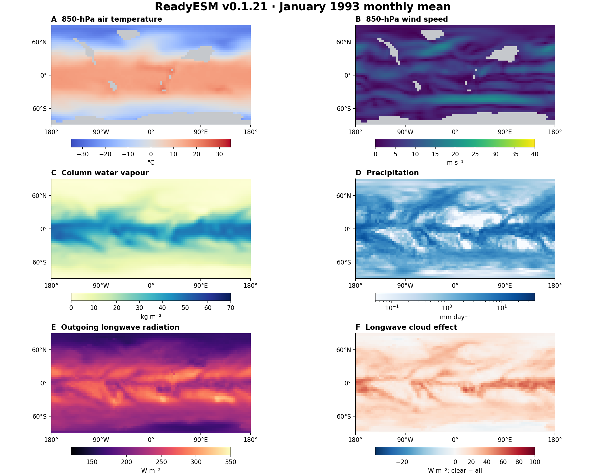
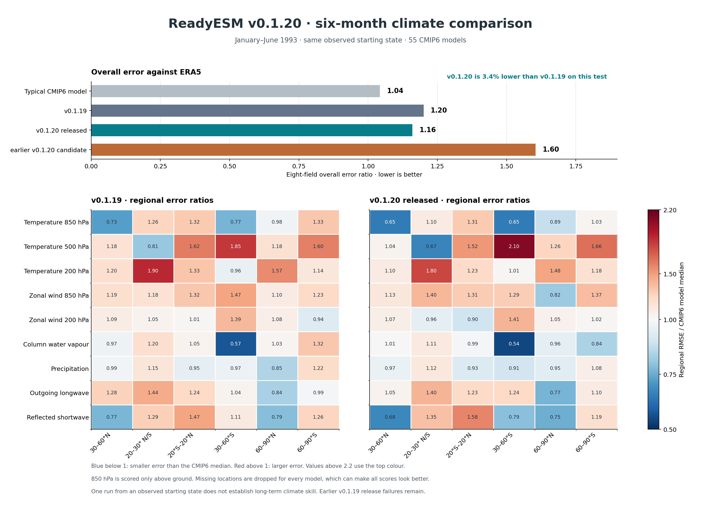
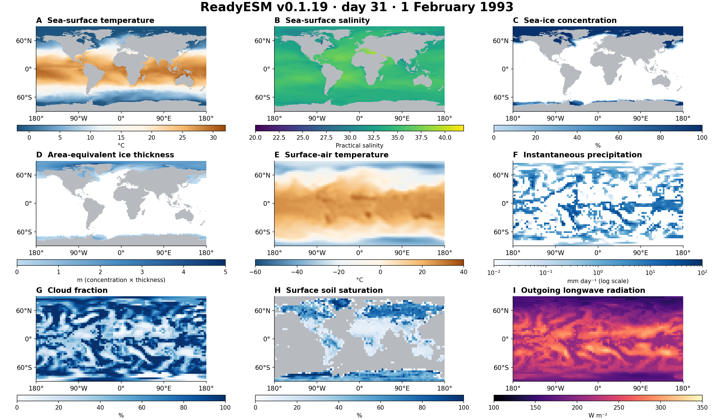
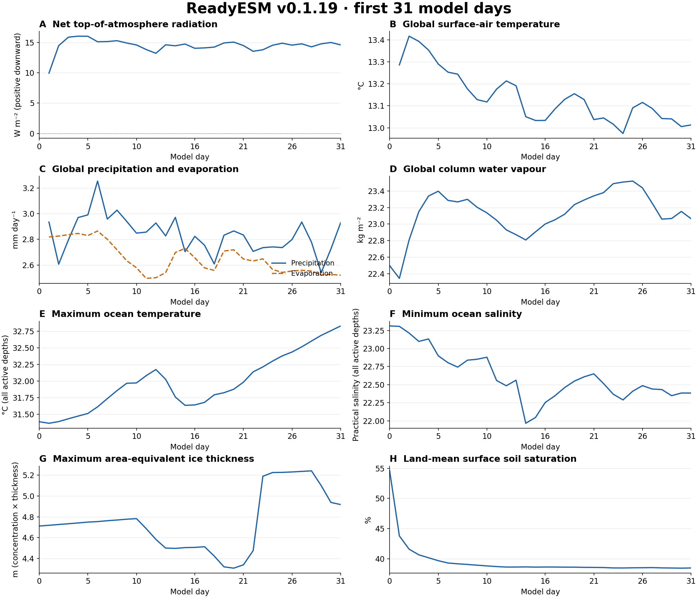
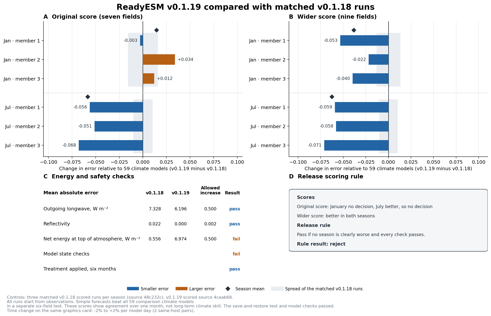

# ReadyESM

ReadyESM is a global climate model written in Julia. It couples SpeedyWeather
for the atmosphere, RRTMGP for radiation, Oceananigans for the ocean,
ClimaSeaIce for sea ice and Terrarium for land.

In the standard setup, the atmosphere has a grid spacing of about 400 km
(spectral resolution T31) and 27 levels. The ocean has a grid spacing of
about 1 degree and 60 levels. The land has 16 soil layers. ERA5 supplies the
initial atmosphere and land state. ECCO supplies the ocean and sea ice.



These are January means from one 181-day run starting from observations on
1 January 1993, using the v0.1.21 production physics at source `39647467`.
The maps show atmospheric and top-of-atmosphere radiation fields. They do not
show the ocean, sea ice or land. Grey marks locations where 850 hPa is below
ground or lacks complete hourly coverage. White in the precipitation map
means no rain. The 31-day mean is not a long-term climate mean. The
[figure record](docs/readiesm-v0.1.21-january-monthly.json) gives input and
image hashes. The [plot recipe](docs/plot-v0.1.21-january-monthly.py)
recreates it from the sealed six-month run.

## v0.1.21 climate comparison



One continuous January–June 1993 run per version starts from the same
observations. The frozen score uses March–June monthly fields on one
common-valid mask. The eight-field overall error ratio is **1.18** for
v0.1.21, against **1.16** for v0.1.20 and **1.20** for v0.1.19; the typical
model among 55 CMIP6 models scores **1.04**. Lower is better. The v0.1.21
increase of 0.0185 is a recorded limit within the single-start month-choice
spread. The northern midlatitude 500-hPa temperature is colder and less
accurate than in v0.1.20. Missing locations are excluded for all models;
the 850-hPa rule uses ERA5 surface pressure above 875 hPa and shared finite
data; some model values below their own surface may remain. The mask can
change scores or ranks. One observed start does not show long-term climate
skill. See the
[validation record](docs/validation-v0.1.21.md),
[scorecard values and hashes](docs/scorecard-v0.1.21-partc.json), and
[plot recipe](docs/plot-v0.1.21-scorecard.py). The
[release figure manifest](docs/release_figure_manifest.json) records the
published image hashes and keeps the historical cards.

The standard setup now uses 1993 greenhouse-gas values and historical
monthly ozone, with a monthly upper radiative cap and a 0.4 minimum relative
humidity for diagnostic clouds. Its January–June global net top-of-atmosphere
bias improves from +2.30 to +0.55 W m⁻² against ERA5; clear-sky outgoing
longwave bias improves from −7.07 to −3.17 W m⁻². A qualified calendar
restart resumes without a second state update. The winter model top remains
too cold, and multi-year climate behaviour remains unqualified.

## v0.1.19 historical figures



January 1993, first of three runs, after 31 days with v0.1.19 source
`4caab689`.
This run starts from observations. It is one run, not a long-term climate
mean. Grey marks inactive cells. Ice-free ocean is white.



The same run from day 0 to day 31. Radiation shows daily means. Other panels
show daily samples. Ocean extrema cover all active depths and can move between
cells.
[Figure data, source hashes and methods](docs/readiesm-v0.1.19-figures.json).

### v0.1.19 paired comparison



Three 31-day runs in each season compare v0.1.19 with v0.1.18 from the same
observed starts. Error across nine weather fields fell in both seasons.
The frozen release score nevertheless **rejected** v0.1.19. The two-season
absolute imbalance in energy at the top of the atmosphere grew from 0.56 to
6.97 W m⁻², against an allowance of 0.5 W m⁻² for the change. At the end of
January, Antarctic sea-ice extent was 4.17–4.30 million km² in v0.1.19,
against 3.00–3.03 million km² in the controls and 2.96 million km² in daily
observations. This is a **qualified release with known failures**. The score
and failed checks are unchanged. See the
[validation record](docs/validation-v0.1.19.md) and
[figure values and source hashes](docs/readiesm-v0.1.19-comparison.json).
The [plot recipe](docs/plot-v0.1.19-comparison.py) renders the comparison
from that figure record.
The [v0.1.19 paired scorecard](docs/scorecard-v0.1.19.png) is archived
separately from the current six-month card.

In a separate six-month run from a January 1993 start, the June air
temperature about 5.5 km above sea level between 30 and 60°N was 0.83°C
too cold, compared with 5.32°C too cold using the matched v0.1.18 settings.
That is one pair of runs. It does not show how a stable climate would behave.
The model uses 1365 W m⁻² for the Sun's energy output. The same value was
used in earlier versions. In this six-month run, incoming sunlight averaged
0.89 W m⁻² above the ERA5 reference. This explains only part of the energy
imbalance. The remaining causes are under investigation.

These runs start from observations. In a separate six-field test, two simple
guesses (the long-term average, and the starting difference from that average
held fixed) scored better than all 59 CMIP6 models. The ranks here show
agreement with the observed month, not the skill of the model's own long-term
climate. The [current six-month scorecard](scorecard.png),
[development scorecard](development_scorecard.png) and
[version history](readyesm_scorecard_versions.png) have different scopes.
The current card above shows the v0.1.21 climate comparison. The development
card adds the v0.1.21 release row from one continuous 181-day run; its programme
panels retain the reviewed 1 November inventory. The version
history shows the v0.1.21 result in a separate top panel. Its lower panels
preserve the older January and July series, which use one start per season
and a different 31-day method. The paired v0.1.19 evidence and its failed
checks remain historical. The [version-history figure record](docs/readyesm_scorecard_versions_v021.json)
gives the new figure hashes, and the [archived v0.1.19 figure](docs/readyesm_scorecard_versions_v019.png)
preserves its original pixels. The [historical paired score values](scorecard_v4_data.json)
preserve the older comparison. The [development figure provenance](docs/development_scorecard_v021_provenance.json)
gives the new card's source hashes and remaining limits.

## Speed

Measured on 20 October 2026, before v0.1.14, on JASMIN with one NVIDIA
A100 40 GB and four CPU threads.
Two fresh processes each timed three model days after warm-up.

| Atmosphere | Ocean cells | Simulated years per day | Start-up |
| --- | --- | ---: | ---: |
| T15, 27 levels | 180×90×60 | 15.1 | 45–52 min |
| T15, 27 levels | 360×180×60 | 11.1 | 45–51 min |
| T15, 27 levels | 720×360×60 | 4.5 | 47–53 min |
| T31, 27 levels | 180×90×60 | 8.2 | 45–52 min |
| T31, 27 levels | 360×180×60 | 5.7 | 46–53 min |
| T31, 27 levels | 720×360×60 | 2.4 | 48–54 min |
| T63, 27 levels | 360×180×60 | 3.0 | 48–54 min |
| T127, 27 levels | 360×180×60 | 1.1 | 55–61 min |

The rate covers integration with daily budget diagnostics. Start-up includes
loading, model construction, initialization and warm-up.
T63 and T127 used a wider land-data search for a few island cells during
initialization, for timing only.
[Timing details](docs/performance.md).

ReadyESM also has a bounded package-precompile workload on the v0.2
development line. It changes first-use and cache-creation costs, and has not
changed the v0.1.19 production speed measurements above. See the
[precompile mode and measurement guide](docs/precompile-performance-v020.md)
before choosing a cache mode or reusing a compiled depot.

## Run

Use Julia 1.12 and Python 3.11 or newer. The standard configuration uses an NVIDIA GPU
with CUDA. The project asks for CUDA runtime 13.2. Check that your NVIDIA
driver supports it. CPU runs are also supported.

```bash
git clone https://github.com/kieranmrhunt/ReadyESM.git
cd ReadyESM
julia --project=. -e 'using Pkg' -e 'Pkg.instantiate()'
python -m pip install -r scripts/requirements.txt
```

Follow the [input-data setup](docs/running.md#input-data) to prepare ERA5,
ECCO and the prescribed aerosol inputs for 1 January 1993. The aerosol
[download hashes and preparation commands](data/README_aerosol.md) are supplied
separately because the source data are not in this repository. Then copy the
standard configuration:

```bash
cp config/production.yml config/my_run.yml
```

For a 31-day run, change these entries in the copied file:

```yaml
name: my_run
duration_days: 31
analysis_start_day: 0
output_dir: artifacts/my_run
```

Start the model from the repository directory:

```bash
julia --project=. scripts/run_dynamic_esm.jl config/my_run.yml
```

The first model build and GPU compilation can take hours. Results are written
to the configured output directory. To plot the final day and timelines:

```bash
python scripts/plot_readme.py artifacts/my_run/diagnostics.nc \
    artifacts/my_run/summary --version v0.1.21 --expected-days 31
```

For files of monthly and yearly climate fields, see the
[climate output guide](docs/climate-output.md). For the week-by-week
temperature comparison with ERA5, see the
[drift-screen guide](docs/drift-screen.md).
The standard settings return energy lost from the wind to the air as heat.
They also use monthly ERA5 land brightness, plant cover and leaf area. Their
input files and recorded hashes are in
`data/era5_seasonal_land_cycle_1993/` and
`data/era5_realistic_albedo_1993/`. The current setup also requires the
prepared prescribed aerosol files described above. See the
[v0.1.21 validation record](docs/validation-v0.1.21.md)
and [known limitations](NOTES.md).

## Configuration

Edit the existing entries in the YAML file. Forcing options sit under
`forcing:`.

| Option | Standard value | Meaning |
| --- | --- | --- |
| `device` | `gpu` | Use `gpu` or `cpu`. |
| `truncation`, `nlayers` | `31`, `27` | Atmospheric horizontal truncation and vertical levels. |
| `duration_days`, `analysis_start_day` | `730`, `365` | Run length and a recorded analysis-start day. The current runner saves `analysis_start_day` in the metadata. It does not use it to choose which days to average. It must be less than `duration_days`. |
| `atmosphere_hyperdiffusion_hours` | `4` | Time over which the model smooths small-scale noise in wind, temperature and humidity. A longer time gives weaker smoothing. |
| `atmosphere_divergence_hyperdiffusion_hours` | `4` | Time over which the model smooths the divergent part of the wind. v0.1.16 used 1 hour. A restart from a saved state with a different value stops with an error. |
| `atmosphere_vertical_advection` | `centered_full_temperature` | Transport full temperature vertically. Select `speedyweather_0_21_1_centered` for the older advection behaviour in a new run. Checkpoints from earlier releases cannot be restarted directly in v0.1.17. |
| `atmosphere_vertical_diffusion` | `holtslag_boville_k_profile_v1` | Mix momentum vertically in the atmospheric boundary layer. Requires Oceananigans and Terrarium. |
| `atmosphere_pbl_diffusivity_scale` | `1.0` | Multiply the boundary-layer mixing coefficient by a value greater than 0 and at most 1. |
| `atmosphere_pbl_mix_heat`, `atmosphere_pbl_mix_humidity`, `atmosphere_pbl_mix_momentum` | `false`, `false`, `true` | Select the fields mixed by the boundary-layer scheme. |
| `atmosphere_dissipative_heating` | `kinetic_energy_v1` | Return diagnosed wind-energy losses from drag, mixing and numerical smoothing as heat. The generic experiment default is `off`. |
| `atmosphere_convection` | `betts_miller_sigma_rh_v1` | Betts–Miller with a vertical humidity profile. Use `betts_miller_constant_rh` for the previous scheme. |
| `atmosphere_convection_upper_relative_humidity`, `atmosphere_convection_lower_relative_humidity` | `0.5`, `0.7` | Reference relative humidity above and below the transition. |
| `atmosphere_convection_transition_top_sigma`, `atmosphere_convection_transition_bottom_sigma` | `0.3`, `0.7` | Bounds of the linear transition in pressure fraction. |
| `atmosphere_convection_timescale_seconds` | `7200` | Betts–Miller adjustment time. |
| `atmosphere_saturation_law` | `mixed_phase` | Use the mixed liquid/ice saturation law. |
| `sea_ice_dynamics` | `true` | Set to `false` to disable ice motion. |
| `sea_ice_lead_closing_thickness_m` | `0.5` | New ice closes open-water leads at an effective 0.5 m thickness in the standard setup. Values from 0.05 to 2 m are available. |
| `sea_ice_lead_closing_thickness_south_m` | unset | Optionally give the Southern Hemisphere a different lead-closing thickness. Unset applies 0.5 m globally. A value of 0 selects the older consolidation rule in the south. The two explicit values must differ. |
| `sea_ice_branch_observer` | `false` | Opt in to a read-only record of each sea-ice thermodynamic step. It does not change the model. `scripts/run_dynamic_esm.jl` writes the record to `sea_ice_branch_observer_v1/` in the output folder. |
| `atmosphere_moist_mass_coupling` | `false` | Let water-vapour sources change the air mass. Evaporation adds air and precipitation removes it, and the global mean surface pressure follows. Use it only with Betts–Miller convection, net-column large-scale precipitation and RRTMGP radiation. |
| `terrarium_runoff_enthalpy` | `false` | Route the heat carried by land runoff to the ocean. See the [runoff guide](docs/bs08-runoff-enthalpy.md). |
| `terrarium_unsat_conductivity` | `van_genuchten_released` | Keep the established soil-water conductivity law, or opt in to the standard van Genuchten–Mualem law with `van_genuchten_mualem`. |
| `terrarium_surface_albedo` | `era5_spectral` | Use the packaged monthly land brightness from ERA5 for coupled runs. The generic experiment default is `constant`. See [seasonal albedo](docs/seasonal-albedo.md). |
| `terrarium_vegetation_cycle` | `cover_lai` | Prescribe monthly ERA5 vegetation cover and leaf area index. Requires ERA5 Terrarium initialization and `era5_prescribed_vegetation`. The generic experiment default is `off`. See [seasonal vegetation](docs/seasonal-vegetation.md). |
| `scored_outputs` | `true` | Write the four files that the release scores read. Compatible checkpoints include the scored accumulators. The [monthly runner](docs/running.md#run-and-output) seals calendar months with checkpoint pairs. Requires RRTMGP. |
| `forcing.co2_ppm` | `420.0` | Constant CO₂ fallback when no gas file is set. The production gas file overrides this value. |
| `forcing.ch4_ppb`, `forcing.n2o_ppb` | not set | Constant CH₄ and N₂O fallbacks when no gas file is set. The production gas file supplies both. Keep forcing inputs unchanged on restart. |
| `forcing.solar_distance_correction` | `true` | Vary incoming sunlight with seasonal Earth–Sun distance. Requires RRTMGP. See the [solar guide](docs/solar-forcing.md). |
| `forcing.solar_constant_w_m2` | `1360.7470703125` | CMIP6 piControl solar constant in W m⁻². Seasonal Earth–Sun distance still varies it. |
| `forcing.well_mixed_gas_path` | `data/forcing_1993/wmghg_cmip6_ssp245_1850-2100.nc` | Annual CO₂, CH₄, N₂O and halocarbon file packaged for this production run. It overrides constant gas settings and cannot be combined with active carbon mode. See [file forcing](docs/file-forcing.md). |
| `forcing.well_mixed_gas_fixed_year` | `1993` | Hold the packaged gas file at its 1993 values. Set `0` in a transient run to follow the model date. Requires `well_mixed_gas_path`. |
| `forcing.ozone_path` | `data/forcing_1993/o3_cmip6_historical_199201-199512.nc` | Packaged monthly zonal ozone for the 1993–1994 production run. It replaces the analytic ozone profile. See [file forcing](docs/file-forcing.md). |
| `forcing.ozone_fixed_year` | `0` | Follow the model date through the packaged historical ozone months. A nonzero value repeats the twelve months of that year. Requires `ozone_path`. |
| `forcing.upper_radiative_cap_path` | `data/upper_radiative_cap/era5_1993_sampled_monthly_upper_cap.csv` | Apply the sampled monthly upper-atmosphere temperature cap for radiation. See the [cap input record](data/upper_radiative_cap/README.md). |
| `forcing.aerosol_scheme` | `cmip_prescribed` | Use the prepared MACv2 background, MACv2-SP plume and UOEXETER stratospheric inputs. See [input-data setup](docs/running.md#prescribed-aerosols). |
| `forcing.aerosol_optical_depth_550nm` | `0.0` | Leave at zero with `cmip_prescribed`. The separate scalar sulfate setting is incompatible with that scheme. |
| `forcing.radiation_every_n_steps` | `4` | Number of atmosphere steps between radiation calculations. |

**Land brightness:** the fix that makes the radiation use the monthly values
passes its tests. In one July month it warmed the middle atmosphere at 30 to
60 degrees north and changed how much sunlight the planet absorbs. A 90-day
combined test is complete on a development copy of the code. Its effects on
the energy balance and on the upper air still need work. See the
[seasonal albedo guide](docs/seasonal-albedo.md).

The standard setup uses the packaged gas file held at 1993 values, monthly
historical ozone, the sampled monthly upper-radiative cap and prescribed
aerosols. The [file forcing guide](docs/file-forcing.md) describes the gas
and ozone formats, their time coverage and what a restart checks. The cap input is
[documented separately](data/upper_radiative_cap/README.md). To use constant
gases and analytic ozone, clear both file paths in a separate configuration.
Optional [carbon exchange and emissions](docs/carbon.md) requires a configuration
without the gas file. For constant CH₄/N₂O restart settings, see the
[trace-gas notes](docs/validation-runoff-trace-gases.md#scope).
Land vegetation is prescribed. Optional [CPU multi-plume convection](docs/finite-convection.md)
has separate configuration instructions.

For the optional moist-mass coupling, or to restore the v0.1.14 vertical
diffusion settings, use all five entries below. Heat and humidity mixing
are inactive with this operator. Keep the original settings on restart.

```yaml
atmosphere_vertical_diffusion: speedyweather_0_21_1_zero_operator_control
atmosphere_pbl_diffusivity_scale: 1.0
atmosphere_pbl_mix_heat: true
atmosphere_pbl_mix_humidity: true
atmosphere_pbl_mix_momentum: false
```

See [setup and tests](docs/running.md), [known limitations](NOTES.md) and
[version history](HISTORY.md).

Developed by Kieran Hunt with AI coding assistance from Claude and OpenAI Codex.

## Licence

ReadyESM is released under the European Union Public Licence v1.2
(EUPL-1.2). See [LICENSE](LICENSE). The bundled packages in `vendor/` keep
their own licences. The [third-party licences](THIRD_PARTY.md) list them.

The packaged seasonal land inputs contain modified Copernicus Climate Change
Service information 2026 from [ERA5 monthly averaged single-level data](https://cds.climate.copernicus.eu/datasets/reanalysis-era5-single-levels-monthly-means)
(DOI [10.24381/cds.f17050d7](https://doi.org/10.24381/cds.f17050d7)),
licensed under [CC BY 4.0](https://creativecommons.org/licenses/by/4.0/).
Neither the European Commission nor ECMWF is responsible for any use that may
be made of the Copernicus information they contain. The
[realistic-albedo data record](data/era5_realistic_albedo_1993/README.md)
describes the modifications and source hashes.
