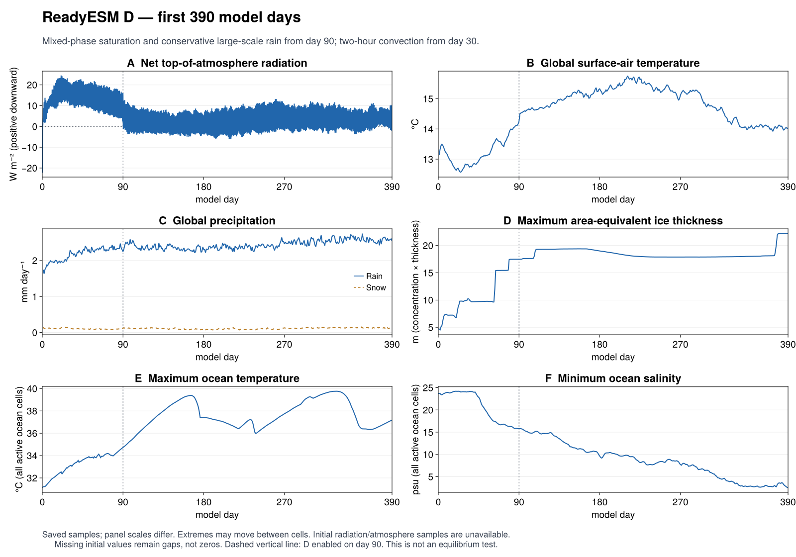

# ReadyESM

ReadyESM is a global climate model written in Julia. It couples SpeedyWeather
for the atmosphere, RRTMGP for radiation, Oceananigans for the ocean,
ClimaSeaIce for sea ice and Terrarium for land.

The standard setup has a T31 atmosphere with 27 vertical levels, a 1° tripolar
ocean with 60 levels, and 16 soil layers. ERA5 supplies the initial atmosphere
and land state. ECCO supplies the ocean and sea ice.




A 390-day initialised run, using v0.1.8 physics from day 90.
[Figure details](docs/readiesm-v0.1.8-snapshot.json).

## Speed

Measured on JASMIN with one NVIDIA A100 40 GB and four CPU threads.
Two fresh processes each timed three model days after warm-up.

| Atmosphere | Ocean cells | Simulated years per day | Start-up |
| --- | --- | ---: | ---: |
| T15, 27 levels | 180×90×60 | 15.1 | 45–52 min |
| T15, 27 levels | 360×180×60 | 11.1 | 45–51 min |
| T15, 27 levels | 720×360×60 | 4.5 | 47–53 min |
| T31, 27 levels | 180×90×60 | 8.2 | 45–52 min |
| T31, 27 levels | 360×180×60 | 5.7 | 46–53 min |
| T31, 27 levels | 720×360×60 | 2.4 | 48–54 min |

The rate covers integration with daily budget diagnostics. Start-up includes
loading, model construction, initialization and warm-up.
[Timing details](docs/performance.md).

## Run

Use Julia 1.12 and Python 3. The standard configuration uses an NVIDIA GPU
with CUDA. CPU runs are also supported.

```bash
git clone https://github.com/kieranmrhunt/ReadyESM.git
cd ReadyESM
julia --project=. -e 'using Pkg' -e 'Pkg.instantiate()'
python -m pip install -r scripts/requirements.txt
```

Follow the [input-data setup](docs/running.md#input-data) to prepare ERA5 and
ECCO for 1 January 1993. Then copy the standard configuration:

```bash
cp config/production.yml config/my_run.yml
```

For a 30-day run, change these entries in the copied file:

```yaml
name: my_run
duration_days: 30
analysis_start_day: 0
output_dir: artifacts/my_run
```

Start the model from the repository directory:

```bash
julia --project=. scripts/run_dynamic_esm.jl config/my_run.yml
```

The first model build and GPU compilation can take hours. Results are written
to the configured output directory. To plot the final day:

```bash
julia --project=. scripts/plot_final_day_summary.jl \
    artifacts/my_run/diagnostics.nc artifacts/my_run/final_day.png
```

## Configuration

Edit the existing entries in the YAML file. Forcing options sit under
`forcing:`.

| Option | Standard value | Meaning |
| --- | --- | --- |
| `device` | `gpu` | Use `gpu` or `cpu`. |
| `truncation`, `nlayers` | `31`, `27` | Atmospheric horizontal truncation and vertical levels. |
| `duration_days`, `analysis_start_day` | `730`, `365` | Run length and start of the diagnostic averaging period. |
| `atmosphere_convection_timescale_seconds` | `7200` | Betts–Miller adjustment time. |
| `sea_ice_dynamics` | `true` | Set to `false` to disable ice motion. |
| `forcing.co2_ppm` | `420.0` | Prescribed CO2 concentration for radiation. |
| `forcing.aerosol_optical_depth_550nm` | `0.0` | Prescribed sulfate aerosol optical depth. |
| `forcing.radiation_every_n_steps` | `4` | Number of atmosphere steps between radiation calculations. |

The model uses prescribed CO2 and aerosol forcing. Land vegetation is
prescribed. Optional [CPU multi-plume convection](docs/finite-convection.md)
has separate configuration instructions.

See [setup and tests](docs/running.md), [known limitations](NOTES.md) and
[version history](HISTORY.md).

Developed by Kieran Hunt with AI coding assistance from Claude and OpenAI Codex.
