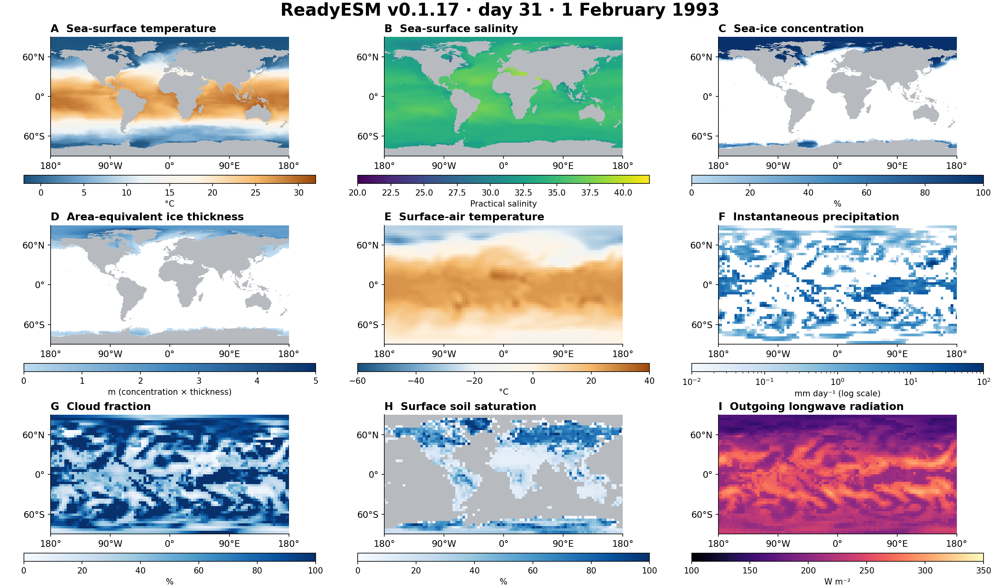
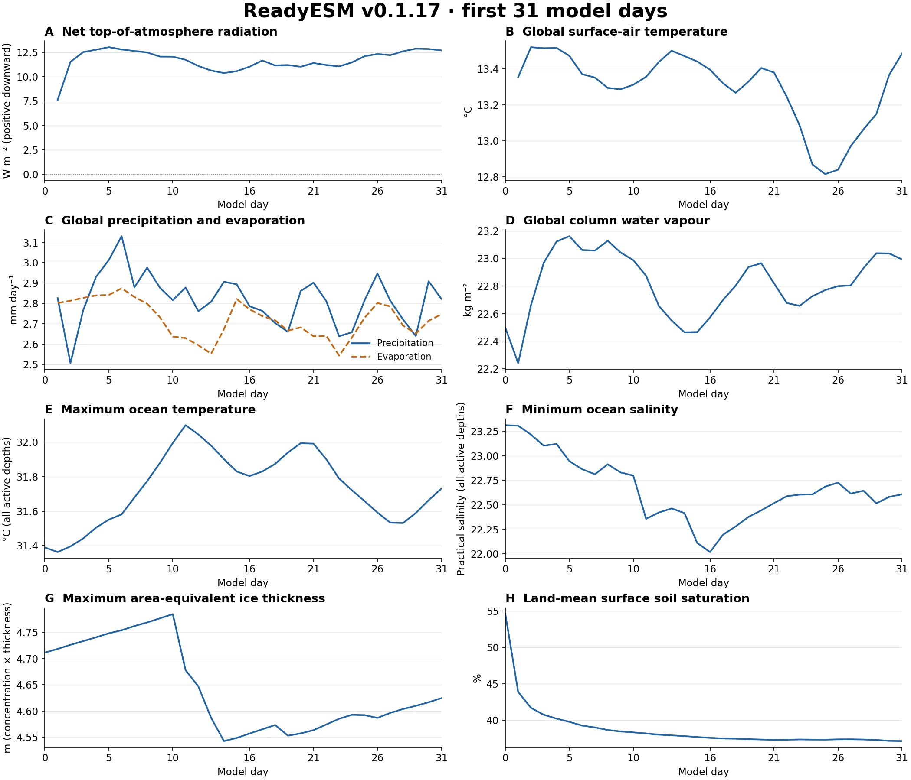
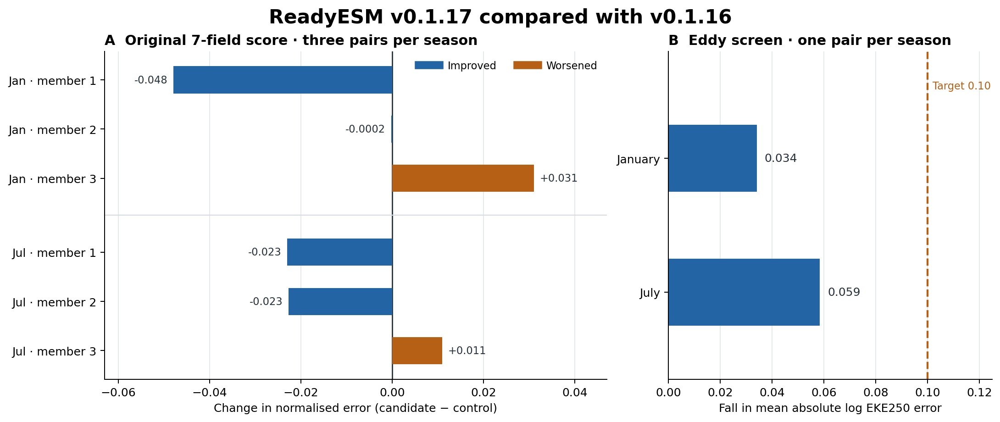

# ReadyESM

ReadyESM is a global climate model written in Julia. It couples SpeedyWeather
for the atmosphere, RRTMGP for radiation, Oceananigans for the ocean,
ClimaSeaIce for sea ice and Terrarium for land.

In the standard setup, the atmosphere has a grid spacing of about 400 km
(spectral resolution T31) and 27 levels. The ocean has a grid spacing of
about 1 degree and 60 levels. The land has 16 soil layers. ERA5 supplies the
initial atmosphere and land state. ECCO supplies the ocean and sea ice.



January 1993 member 1 after 31 days with the v0.1.17 configuration. This is
one run that starts from observations, rather than a long-term climate mean.
Grey marks inactive cells. Ice-free ocean is white.



The same run from day 0 to day 31. Radiation shows daily means. Other panels
show daily samples. Ocean extrema cover all active depths and can move between
cells.
[Figure data and details](docs/readiesm-v0.1.17-figures.json).

## Comparison with v0.1.16



The original score fell for four of six matched 31-day members. Lower is
better. The three-member January mean was neutral under the release rule,
and the July mean improved. The separate upper-level eddy screen used one
matched member per season. Its improvement missed the predeclared target
in both seasons. See the [validation results](docs/validation-v0.1.17.md),
the [figure values and source hashes](docs/readiesm-v0.1.17-comparison.json)
and the [plot recipe](docs/plot-v0.1.17-comparison.py).

## Speed

Measured on 20 October 2026, before v0.1.14, on JASMIN with one NVIDIA
A100 40 GB and four CPU threads.
Two fresh processes each timed three model days after warm-up.

| Atmosphere | Ocean cells | Simulated years per day | Start-up |
| --- | --- | ---: | ---: |
| T15, 27 levels | 180×90×60 | 15.1 | 45–52 min |
| T15, 27 levels | 360×180×60 | 11.1 | 45–51 min |
| T15, 27 levels | 720×360×60 | 4.5 | 47–53 min |
| T31, 27 levels | 180×90×60 | 8.2 | 45–52 min |
| T31, 27 levels | 360×180×60 | 5.7 | 46–53 min |
| T31, 27 levels | 720×360×60 | 2.4 | 48–54 min |
| T63, 27 levels | 360×180×60 | 3.0 | 48–54 min |
| T127, 27 levels | 360×180×60 | 1.1 | 55–61 min |

The rate covers integration with daily budget diagnostics. Start-up includes
loading, model construction, initialization and warm-up.
T63 and T127 used a wider land-data search for a few island cells during
initialization, for timing only.
[Timing details](docs/performance.md).

## Run

Use Julia 1.12 and Python 3.11 or newer. The standard configuration uses an NVIDIA GPU
with CUDA. CPU runs are also supported.

```bash
git clone https://github.com/kieranmrhunt/ReadyESM.git
cd ReadyESM
julia --project=. -e 'using Pkg' -e 'Pkg.instantiate()'
python -m pip install -r scripts/requirements.txt
```

Follow the [input-data setup](docs/running.md#input-data) to prepare ERA5 and
ECCO for 1 January 1993. Then copy the standard configuration:

```bash
cp config/production.yml config/my_run.yml
```

For a 31-day run, change these entries in the copied file:

```yaml
name: my_run
duration_days: 31
analysis_start_day: 0
output_dir: artifacts/my_run
```

Start the model from the repository directory:

```bash
julia --project=. scripts/run_dynamic_esm.jl config/my_run.yml
```

The first model build and GPU compilation can take hours. Results are written
to the configured output directory. To plot the final day and timelines:

```bash
python scripts/plot_readme.py artifacts/my_run/diagnostics.nc \
    artifacts/my_run/summary --version v0.1.18 --expected-days 31
```

## Configuration

Edit the existing entries in the YAML file. Forcing options sit under
`forcing:`.

| Option | Standard value | Meaning |
| --- | --- | --- |
| `device` | `gpu` | Use `gpu` or `cpu`. |
| `truncation`, `nlayers` | `31`, `27` | Atmospheric horizontal truncation and vertical levels. |
| `duration_days`, `analysis_start_day` | `730`, `365` | Run length and a recorded analysis-start day. The current runner saves `analysis_start_day` in the metadata. It does not use it to choose which days to average. It must be less than `duration_days`. |
| `atmosphere_hyperdiffusion_hours` | `4` | Time over which the model smooths small-scale noise in wind, temperature and humidity. A longer time gives weaker smoothing. |
| `atmosphere_divergence_hyperdiffusion_hours` | `4` | Time over which the model smooths the divergent part of the wind. v0.1.16 used 1 hour. A restart from a saved state with a different value stops with an error. |
| `atmosphere_vertical_advection` | `centered_full_temperature` | Transport full temperature vertically. Select `speedyweather_0_21_1_centered` for the older advection behaviour in a new run. Checkpoints from earlier releases cannot be restarted directly in v0.1.17. |
| `atmosphere_vertical_diffusion` | `holtslag_boville_k_profile_v1` | Mix momentum vertically in the atmospheric boundary layer. Requires Oceananigans and Terrarium. |
| `atmosphere_pbl_diffusivity_scale` | `1.0` | Multiply the boundary-layer mixing coefficient by a value greater than 0 and at most 1. |
| `atmosphere_pbl_mix_heat`, `atmosphere_pbl_mix_humidity`, `atmosphere_pbl_mix_momentum` | `false`, `false`, `true` | Select the fields mixed by the boundary-layer scheme. |
| `atmosphere_convection` | `betts_miller_sigma_rh_v1` | Betts–Miller with a vertical humidity profile. Use `betts_miller_constant_rh` for the previous scheme. |
| `atmosphere_convection_upper_relative_humidity`, `atmosphere_convection_lower_relative_humidity` | `0.5`, `0.7` | Reference relative humidity above and below the transition. |
| `atmosphere_convection_transition_top_sigma`, `atmosphere_convection_transition_bottom_sigma` | `0.3`, `0.7` | Bounds of the linear transition in pressure fraction. |
| `atmosphere_convection_timescale_seconds` | `7200` | Betts–Miller adjustment time. |
| `sea_ice_dynamics` | `true` | Set to `false` to disable ice motion. |
| `atmosphere_moist_mass_coupling` | `false` | Let water-vapour sources change the air mass. Evaporation adds air and precipitation removes it, and the global mean surface pressure follows. Use it only with Betts–Miller convection, net-column large-scale precipitation and RRTMGP radiation. |
| `terrarium_runoff_enthalpy` | `false` | Route the heat carried by land runoff to the ocean. See the [runoff guide](docs/bs08-runoff-enthalpy.md). |
| `scored_outputs` | `false` | Write the four files that the release scores read. See [Run and output](docs/running.md#run-and-output). Requires RRTMGP. A run with this switch on cannot be restarted. |
| `forcing.co2_ppm` | `420.0` | Prescribed CO2 concentration for radiation. |
| `forcing.ch4_ppb`, `forcing.n2o_ppb` | not set | Prescribed CH4 and N2O for RRTMGP. Omitted values use 1900 and 340 ppb. Keep these settings unchanged on restart. |
| `forcing.solar_distance_correction` | `true` | Vary incoming sunlight with seasonal Earth–Sun distance. Requires RRTMGP. See the [solar guide](docs/solar-forcing.md). |
| `forcing.aerosol_optical_depth_550nm` | `0.0` | Prescribed sulfate aerosol optical depth. |
| `forcing.radiation_every_n_steps` | `4` | Number of atmosphere steps between radiation calculations. |

The standard setup uses prescribed CO2 and aerosol forcing. Optional
[carbon exchange and emissions](docs/carbon.md) can update CO2.
For CH4/N2O restart settings, see the [trace-gas notes](docs/validation-runoff-trace-gases.md#scope).
Land vegetation is prescribed. Optional [CPU multi-plume convection](docs/finite-convection.md)
has separate configuration instructions.

For the optional moist-mass coupling, or to restore the v0.1.14 vertical
diffusion settings, use all five entries below. Heat and humidity mixing
are inactive with this operator. Keep the original settings on restart.

```yaml
atmosphere_vertical_diffusion: speedyweather_0_21_1_zero_operator_control
atmosphere_pbl_diffusivity_scale: 1.0
atmosphere_pbl_mix_heat: true
atmosphere_pbl_mix_humidity: true
atmosphere_pbl_mix_momentum: false
```

See [setup and tests](docs/running.md), [known limitations](NOTES.md) and
[version history](HISTORY.md).

Developed by Kieran Hunt with AI coding assistance from Claude and OpenAI Codex.

## Licence

ReadyESM is released under the European Union Public Licence v1.2
(EUPL-1.2). See [LICENSE](LICENSE). The bundled packages in `vendor/` keep
their own licences. The [third-party licences](THIRD_PARTY.md) list them.
